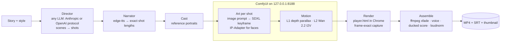

# Hakawati Studio · حكواتي

*English first — [النسخة العربية في الأسفل](#ar).*

A local story-to-film platform. You paste a story; an AI director cuts it into scenes and shots, a neural narrator records it, every shot is painted (SDXL in a local ComfyUI, or animated SVG), set in motion, rendered frame-exactly in Chrome and cut by ffmpeg into an MP4 with music and subtitles. Runs on one Windows PC with an 8 GB NVIDIA card; Node 22, no cloud services except the text engine and the voice.

## Architecture



- **Text engine** (`lib/llm.mjs`): one client for every provider — `openai` = `POST {base}/chat/completions`, `anthropic` = `POST {base}/v1/messages`; streamed; JSON asked in words and validated. The owner uses the CodeCraft gateway (text only).
- **Pictures** (`lib/image.mjs`, `lib/prompts.mjs`): the text engine writes one SDXL prompt per shot; ComfyUI paints it (`POST /prompt` → `/history` → `/view`). The image model never draws text — titles and subtitles are laid on by the player.
- **Motion ladder** (in progress): L1 = 2.5D parallax from a Depth Anything V2 depth map + camera move (every shot); L2 = Wan 2.2 TI2V-5B image-to-video for action shots. The director labels each shot's level.
- **Render** (`lib/render.mjs`, `public/player.html`): Chrome (playwright-core) loads the player, every animation is paused and seeked to each frame's time, frames are captured over CDP and piped to ffmpeg — deterministic, no dropped frames.
- **Incremental**: every asset is keyed by a content hash, so after an edit only the changed shots are redone.

## Quick start (Windows)

**One click:** download the repo ZIP, double-click `scripts\install-all.bat`. It installs the tools, clones the Studio to `E:\hakawati`, installs ComfyUI to `E:\ComfyUI` with the custom nodes and all models (~37 GB, resumable), writes the picture settings and runs the setup check. `-DryRun` shows what it would do; `-Proxy` / `-HfEndpoint https://hf-mirror.com` for blocked networks.

By hand, step by step with exact model files: **[docs/SETUP-WINDOWS.md](docs/SETUP-WINDOWS.md)** (Arabic: [docs/SETUP-WINDOWS.ar.md](docs/SETUP-WINDOWS.ar.md)).

1. Install Node 22 LTS, Git, ffmpeg (gyan.dev, on PATH), Python 3.12 + `python -m pip install -U edge-tts`, Google Chrome.
2. `npm install` in the repo folder.
3. Pictures (optional): ComfyUI portable in `E:\ComfyUI` with the models in the setup guide.
4. `scripts\start-comfyui.bat`, then `scripts\start-studio.bat` → http://127.0.0.1:4848.
5. `powershell -ExecutionPolicy Bypass -File scripts\check-setup.ps1` prints what is missing.

Without a key or GPU the offline `mock` engine still makes a complete (vector) film — useful to test the toolchain.

## Command line

The Studio's buttons call the same pipeline.

```bat
node make.mjs new <story.txt> [--style photoreal] [--aspect 16:9|9:16|1:1] [--length 60] [--lang ar|en|fr] [--title "…"]
node make.mjs run <projectId> [all|script|film|voice,cast,art,render,assemble] [--shots s1-1,s2-3] [--note "…"] [--force]
```

- `new` prints the project id (`YYYY-MM-DD-slug`). Defaults: style `cinematic`, aspect `16:9`, 60 s, Arabic.
- `run … all` = screenplay + film; `film` = everything after the screenplay; or list steps. `--shots` limits art/voice to those shots; `--note` passes a producer note to the painter; `--force` redoes even unchanged assets.
- Styles: `photoreal`, `cinematic`, `paper`, `shadow`, `storybook`, `neon`, `miniature`, `explainer`.
- Output: `projects/<id>/final/<name>.mp4`, `.srt`, `thumbnail.jpg`. Working files: `audio/`, `cast/`, `images/`, `art/`, `thumbs/`, `clips/`, `history/` (old screenplays).

## Studio tour

- **Sidebar**: your stories, **＋ New story**, the engine chip (opens **Engine and settings**), and the **العربية / English** switch. The interface is English by default; story language is chosen per story.
- **New story**: story text, visual style, frame (16:9 / 9:16 / 1:1), narration language, length, narrator voice, subtitles, music, consistent characters, notes for the director.
- **Story** tab: edit and save; **🎬 Write the screenplay** (old versions go to `history/`).
- **Storyboard** tab: every scene and shot — narration line, what we see / what moves, shot size, camera move, transition, length; the generated picture prompt; **Paint again with a note**; **▶ Live preview** (animatic with the real voices); **🎙 Record voices**; **🎨 Paint what is missing**. Edits autosave.
- **Characters & look** tab: title, logline, music mood, film look, palette, places, characters with their look; reference portraits used by IP-Adapter.
- **Screening room** tab: pipeline status, **🎞 Make the film / Update the film**, **↻ Film again**, the film player, downloads (MP4, SRT, thumbnail).
- **Job dock** (bottom): one job at a time, live log and progress, **⏹ Stop**.
- **Settings**: text engine (ready-made presets incl. CodeCraft, protocol, model, Base URL, key, **🔌 Test the connection**), **Pictures** (Off / ComfyUI, address, checkpoint, steps, CFG, sampler, scheduler, negative prompt, IP-Adapter and weight, **🔌 Test ComfyUI**), narrator voices per language, rate/pitch, render quality and fps.

## Privacy

- The Studio listens on `127.0.0.1` only and rejects foreign `Host`/`Origin` headers. ComfyUI is started on `127.0.0.1` as well.
- API keys are stored only in `.studio/settings.json` on this computer, sent only to the engine's own Base URL, and shown masked in the browser. `.studio/` and `projects/` are in `.gitignore` — never commit or share them.
- What leaves the machine: the story and prompts to the text engine you choose; narration text to Microsoft's edge-tts service; font requests to Google Fonts (Aref Ruqaa, Cairo, Playfair Display) from the UI and the player. Pictures, motion, rendering and assembly are local.
- Every text-engine call is logged locally to `.studio/llm-usage.jsonl`.

## Repository

| Path | Role |
|---|---|
| `server.mjs` | Studio server (node:http, 127.0.0.1, SSE job events, Range media) |
| `make.mjs` | CLI |
| `lib/pipeline.mjs` | steps script → voice → cast → art → render → assemble, hash-keyed |
| `lib/director.mjs`, `lib/prompts.mjs` | screenplay; SDXL prompts per shot and per character |
| `lib/llm.mjs`, `lib/settings.mjs` | provider-agnostic text client; settings and presets |
| `lib/image.mjs` | ComfyUI client (SDXL + IP-Adapter workflow) |
| `lib/art.mjs`, `lib/svg.mjs`, `lib/mock.mjs` | animated-SVG art path and the offline engine |
| `lib/voice.mjs`, `lib/timeline.mjs` | edge-tts narration; the single clock (durations, captions, SRT) |
| `lib/render.mjs`, `lib/assemble.mjs` | frame-exact capture; ffmpeg montage and score |
| `lib/i18n.mjs`, `lib/styles.mjs` | UI/log strings (en/ar); styles, cameras, transitions, sizes |
| `public/` | Studio UI (`index.html`, `app.js`, `app.css`) and `player.html` |
| `scripts/` | Windows installer (`install-all`), start scripts, setup check |
| `docs/` | setup guides, test story |

## License

All rights reserved — Soukieh Bros Engineering Press.

---

<a id="ar"></a>

<div dir="rtl">

# استوديو حكواتي

منصة محلية تحوّل الحكاية إلى فيلم. تلصق الحكاية، فيقطّعها مخرج ذكي إلى مشاهد ولقطات، ويسجّلها راوٍ بصوت عصبي، وتُرسم كل لقطة (بـ SDXL في ComfyUI محلي، أو SVG متحرك)، ثم تُحرَّك وتُصوَّر إطاراً بإطار في Chrome، ويركّبها ffmpeg فيلم MP4 بموسيقى وترجمة. تعمل على حاسوب ويندوز واحد ببطاقة NVIDIA ذات 8 GB؛ Node 22، ولا خدمات سحابية سوى محرك النصوص والصوت.

## البنية

- **محرك النصوص** (`lib/llm.mjs`): عميل واحد لكل المزوّدين — بروتوكول `openai` أو `anthropic`، بالبث المتدفق، ويُطلب JSON بالكلام ثم يُتحقق منه. المالك يستخدم بوابة CodeCraft (نصوص فقط).
- **الصور** (`lib/image.mjs` و`lib/prompts.mjs`): يكتب محرك النصوص وصف SDXL لكل لقطة، ويرسمه ComfyUI. نموذج الصور لا يكتب نصاً أبداً — العناوين والترجمة يضعها المشغّل.
- **سلّم الحركة** (قيد البناء): المستوى 1 = بارالاكس 2.5D من خريطة عمق Depth Anything V2 مع حركة كاميرا (لكل لقطة)؛ المستوى 2 = تحويل صورة إلى فيديو بـ Wan 2.2 TI2V-5B للقطات الحركة. المخرج يحدد مستوى كل لقطة.
- **التصوير** (`lib/render.mjs` و`public/player.html`): يحمّل Chrome المشغّل، وتُوقف كل حركة وتُضبط على زمن كل إطار، ويُلتقط الإطار ويُمرَّر إلى ffmpeg — نتيجة حتمية بلا إطارات ساقطة.
- **تزايدي**: كل ملف ناتج مربوط ببصمة محتواه، فبعد أي تعديل لا يُعاد إلا ما تغيّر.

المخطط أعلاه (بالإنجليزية) يبيّن تسلسل الخطوات: الحكاية ← المخرج ← الراوي ← الشخصيات ← الرسم ← الحركة ← التصوير ← المونتاج ← MP4 + SRT.

## البدء السريع (ويندوز)

**بنقرة واحدة:** نزّل المستودع بصيغة ZIP وانقر نقراً مزدوجاً على `scripts\install-all.bat`. يثبّت الأدوات، ويستنسخ الاستوديو إلى `E:\hakawati`، ويثبّت ComfyUI في `E:\ComfyUI` مع العقد وكل النماذج (نحو 37 GB، قابل للاستئناف)، ويكتب إعدادات الصور ويشغّل الفحص. الخيار `-DryRun` يعرض ما سيفعله، و`-Proxy` أو `-HfEndpoint https://hf-mirror.com` للشبكات المحجوبة.

يدوياً، خطوة بخطوة بأسماء ملفات النماذج الدقيقة: **[docs/SETUP-WINDOWS.ar.md](docs/SETUP-WINDOWS.ar.md)**.

1. ثبّت Node 22 LTS وGit وffmpeg (بناء gyan.dev على PATH) وPython 3.12 ثم `python -m pip install -U edge-tts`، وGoogle Chrome.
2. نفّذ `npm install` في مجلد المستودع.
3. الصور (اختياري): ComfyUI المحمول في `E:\ComfyUI` مع النماذج المذكورة في الدليل.
4. شغّل `scripts\start-comfyui.bat` ثم `scripts\start-studio.bat` ← ‏http://127.0.0.1:4848.
5. الأمر `powershell -ExecutionPolicy Bypass -File scripts\check-setup.ps1` يطبع ما ينقص.

بلا مفتاح ولا بطاقة رسومية يصنع المحرك التجريبي `mock` فيلماً كاملاً (رسوماً متجهية) — مفيد لاختبار الأدوات.

## سطر الأوامر

</div>

```bat
node make.mjs new <story.txt> [--style photoreal] [--aspect 16:9|9:16|1:1] [--length 60] [--lang ar|en|fr] [--title "…"]
node make.mjs run <projectId> [all|script|film|voice,cast,art,render,assemble] [--shots s1-1,s2-3] [--note "…"] [--force]
```

<div dir="rtl">

- `new` يطبع معرّف المشروع (`YYYY-MM-DD-slug`). الافتراضي: الأسلوب `cinematic`، الإطار `16:9`، ‏60 ثانية، العربية.
- `run … all` = السيناريو والفيلم؛ `film` = كل ما بعد السيناريو؛ أو اذكر الخطوات بأسمائها. `--shots` يحصر الرسم والصوت في لقطات بعينها، و`--note` يمرّر ملاحظة للرسّام، و`--force` يعيد حتى ما لم يتغيّر.
- الأساليب: `photoreal` (سينمائي واقعي)، `cinematic`، `paper`، `shadow` (خيال الظل)، `storybook`، `neon`، `miniature` (منمنمات)، `explainer`.
- الناتج: `projects/<id>/final/` (‏`.mp4` و`.srt` و`thumbnail.jpg`).

## جولة في الاستوديو

- **الشريط الجانبي**: حكاياتك، **＋ حكاية جديدة**، شارة المحرك (تفتح **المحرك والإعدادات**)، وزر التبديل **العربية / English**. الواجهة بالإنجليزية افتراضياً، ولغة السرد تُختار لكل حكاية.
- **حكاية جديدة**: النص، الأسلوب البصري، الإطار، لغة الراوي، الطول، الصوت، الترجمة، الموسيقى، ثبات الشخصيات، ملاحظات للمخرج.
- **الحكاية**: تعديل وحفظ؛ **🎬 اكتب السيناريو** (النسخ القديمة تُحفظ في `history/`).
- **لوحة اللقطات**: كل مشهد ولقطة — سطر السرد، ما نراه وما يتحرك، حجم اللقطة، حركة الكاميرا، الانتقال، الطول؛ وصف الصورة المولَّد؛ إعادة الرسم بملاحظة؛ **▶ معاينة حيّة** بالأصوات الحقيقية؛ تسجيل الأصوات؛ رسم الناقص. الحفظ تلقائي.
- **الشخصيات والأسلوب**: العنوان، الفكرة في سطر، مزاج الموسيقى، مظهر الفيلم، الألوان، الأماكن، الشخصيات، والصور المرجعية التي يستخدمها IP-Adapter.
- **قاعة العرض**: حالة المراحل، **🎞 اصنع الفيلم**، إعادة التصوير، المشغّل، التنزيلات (MP4 وSRT والصورة المصغّرة).
- **شريط المهام** (أسفل الشاشة): مهمة واحدة في كل مرة، سجل حيّ وتقدّم، وزر **⏹ إيقاف**.
- **الإعدادات**: محرك النصوص (محركات جاهزة منها CodeCraft، البروتوكول، النموذج، العنوان، المفتاح، **🔌 اختبر الاتصال**)، **الصور** (إيقاف / ComfyUI، العنوان، النموذج، الخطوات، CFG، المُعايِن، الجدولة، الوصف السلبي، IP-Adapter وقوته، **🔌 اختبر ComfyUI**)، أصوات الراوي لكل لغة، السرعة وطبقة الصوت، جودة التصوير وعدد الإطارات.

## الخصوصية

- يستمع الاستوديو على `127.0.0.1` فقط ويرفض ترويسات `Host`/`Origin` الغريبة، ويُشغَّل ComfyUI على `127.0.0.1` كذلك.
- مفاتيح API محفوظة فقط في `.studio/settings.json` على هذا الحاسوب، ولا تُرسل إلا إلى عنوان المحرك نفسه، وتظهر في المتصفح مقنّعة. المجلدان `.studio/` و`projects/` مستثنيان في `.gitignore` — لا ترفعهما ولا تشاركهما أبداً.
- ما يغادر الجهاز: الحكاية والأوصاف إلى محرك النصوص الذي تختاره، ونص السرد إلى خدمة edge-tts من مايكروسوفت، وطلبات الخطوط من Google Fonts ‏(Aref Ruqaa وCairo وPlayfair Display) في الواجهة والمشغّل. الصور والحركة والتصوير والمونتاج كلها محلية.
- كل استدعاء لمحرك النصوص يُسجَّل محلياً في `.studio/llm-usage.jsonl`.

## الترخيص

جميع الحقوق محفوظة — Soukieh Bros Engineering Press.

</div>
